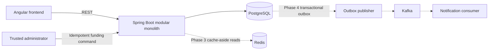

# Architecture

TradeFlow begins as a modular monolith. PostgreSQL owns all financial state; the Angular client accesses that state through REST APIs.

Customer-created accounts always start at zero. Balance increases enter through an administrator-only funding transaction with its own idempotency record and audit trail. Funding and transfer boundaries remain inside PostgreSQL transactions with locked account rows. Redis is never used to approve a balance change, and Kafka publication occurs only after an outbox record has committed.
